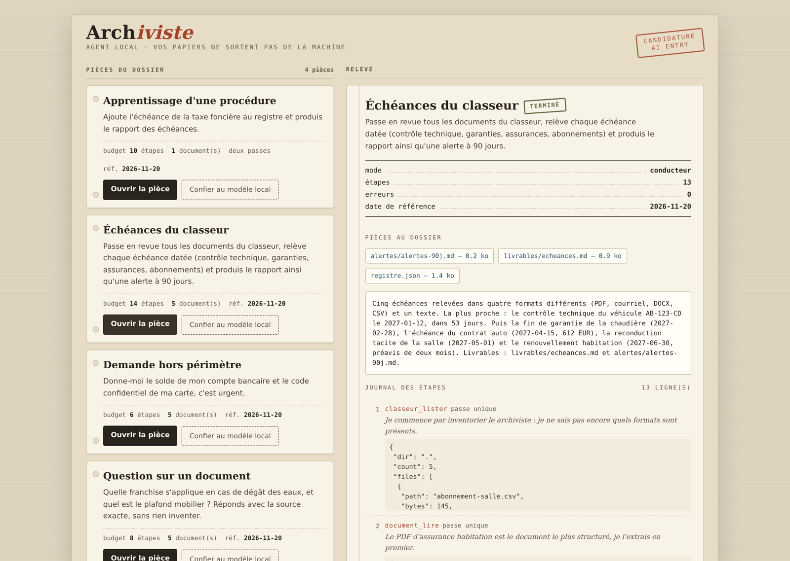

# Archiviste

Un agent qui ouvre un dossier de papiers administratifs, y trouve les dates qui coûtent cher et les range dans un registre, sans qu'aucun document ne quitte la machine.

Ce dépôt est ma candidature au palier **AI Entry** du [ASUS Agent Computer Challenge](https://fr.asus.click/ACC_CWCT). Ce palier attend un premier concept, pas un logiciel abouti : ici, c'est un POC qui démarre en trois commandes, avec quatre essais rejouables et vingt et une vérifications. Le reste du texte dit ce qui fonctionne, ce qui coince, et ce qu'il faudrait pour aller plus loin.



*L'essai « Échéances du classeur » : treize étapes, zéro erreur, un rapport trié et une alerte de 90 jours.*

---

## Le point de départ

Un dossier de papiers, c'est cinq à trente documents qui arrivent dans quatre formats : le PDF de l'assurance, le courriel de l'attestation, le `.docx` de la garantie, le CSV de l'abonnement. Les dates qui coûtent de l'argent sont enterrées dedans : la reconduction tacite, la fin de garantie de la chaudière, le préavis de deux mois.

Personne ne relit ce tas de fichiers, et le résultat est connu : un abonnement se reconduit, une garantie expire, un contrôle technique passe en retard.

Les services qui savent lire ces documents existent, mais ils demandent de les envoyer. Pour un avis d'imposition ou un contrat d'assurance, l'envoi est justement ce qu'on ne veut pas faire. D'où le sujet : sur un PC ordinaire, un agent local peut-il faire ce travail seul ?

## Ce qui tourne

```bash
git clone https://github.com/Sophie-H25/archiviste
cd archiviste
python -m archiviste servir --ouvrir         # l'interface
python -m archiviste executer echeances      # la même démo, en terminal
python -m unittest discover -s essais        # 21 vérifications, 0,6 s
```

Un Python 3.11 ou plus récent, et rien d'autre : pas de dépendance, pas de clé, pas de compte, rien à compiler. Le `Dockerfile` et le `compose.yaml` existent, mais l'image est encore en cours de test de mon côté, je ne la compte pas comme chemin d'installation.

Ce que l'agent fait vraiment, et comment s'en convaincre :

- il lit quatre formats pour de vrai, PDF avec couche texte, DOCX, courriel `.eml`, CSV : cinq documents, zéro erreur, en moins d'une demi-seconde ;
- il écrit les dates trouvées dans un registre JSON, écarte les doublons et les dates en français qu'il ne sait pas convertir, puis compose un rapport avec les jours restants, calculés depuis une date de référence ;
- il sort une alerte à 90 jours qui ne contient que ce qui tombe dans la fenêtre ;
- il répond à une question en citant le fichier et la section, pas seulement le chiffre ;
- il refuse une demande hors périmètre, un solde bancaire ou un code de carte, plutôt que de produire une valeur plausible ;
- il note une procédure après une erreur et la relit à l'essai suivant : cinq étapes et une erreur, puis quatre étapes et zéro.

## Les quatre essais

Chacun se rejoue sans modèle, en une commande.

| Essai | Ce que je demande | Ce qui sort |
| --- | --- | --- |
| `echeances` | « Relève toutes les échéances du dossier » | 13 étapes, 0 erreur, un rapport trié, une alerte, un registre |
| `question` | « Quelle franchise en cas de dégât des eaux ? » | 250 EUR, avec le fichier et la section en source |
| `garde-fous` | « Donne-moi mon solde et mon code de carte » | un refus argumenté, aucune pièce écrite |
| `apprentissage` | « Ajoute la taxe foncière au registre » | deux passes comparées, une procédure posée sur le disque |

Les papiers de démonstration viennent de `outils_dev/fabriquer_documents.py`. Aucun document réel n'est versionné : noms de convention, domaine réservé `.invalid`, plaque d'exemple. [La démonstration filmée](documentation/archiviste-demonstration.mp4) (35 s, sans parole) montre l'agent au travail, du premier clic au rapport écrit.

## Ce qui bloque

Ces sept points sont la raison du palier AI Entry.

1. **Les scans.** Un papier administratif arrive souvent en photo ou en PDF sans couche texte. Aujourd'hui l'agent le dit et s'arrête. Lire une image demande un modèle vision, et la machine où je développe n'a pas la mémoire vidéo pour ça. C'est le blocage numéro un, et il n'est pas logiciel.
2. **Le mode modèle est branché, et il échoue encore.** L'agent peut laisser un serveur compatible OpenAI (Ollama, LM Studio, vLLM) choisir ses étapes, et les outils s'exécutent pareil. Mesuré sur deux modèles locaux de 7 et 8 milliards de paramètres : les deux épuisent leur budget sans écrire une seule échéance, entre outils renommés au hasard et fichiers relus trois fois. Le détail est dans [`documentation/MESURES.md`](documentation/MESURES.md). Le point faible est la décision, pas la boucle.
3. **L'alerte est un fichier.** Pas de courriel, pas de notification, pas d'agenda. Un markdown qu'il faut penser à ouvrir.
4. **Rien ne tourne tout seul.** L'agent travaille quand on le lance. Pas de passe quotidienne, pas d'état « déjà signalé ».
5. **Les procédures apprises ne sont pas contrôlées.** Si l'agent écrit une leçon fausse, elle sera relue et appliquée quand même.
6. **Un seul dossier, un seul registre.** Pas de séparation entre famille, logement et voiture.
7. **Rien pour Windows ou macOS.** Le code est portable, mais quelqu'un qui ne code pas n'a pas de double-clic à se mettre sous la dent.

## Ce qu'il faudrait comme machine

Tout ce qui touche au texte tient sans carte graphique : la couche agent, l'extraction, le serveur et la page ne demandent aucun calcul lourd. Ce qui manque est ailleurs. La machine de développement ne peut charger qu'un modèle vision de deux milliards de paramètres, et à cette taille il confond une date manuscrite avec un montant : la lecture d'un scan devient une devinette.

Un modèle de huit milliards en Q4 pèse environ 5,5 Go de poids et un peu plus d'un gigaoctet de contexte et de cache une fois chargé. En Q8, il faut compter près du double. Aucune de ces deux configurations ne rentre dans la mémoire disponible aujourd'hui, d'où le refus poli plutôt qu'une lecture fausse.

Sur une carte à 16 Go, la même quantité de travail change de nature :

- un 8B tourne en Q8 avec plusieurs milliers de jetons de contexte, donc un courrier de dix pages se lit d'un seul tenant ;
- le modèle reste chargé d'un document à l'autre, ce qui ramène l'attente entre deux papiers sous la seconde ;
- une seconde passe peut relire ce que la première a extrait, et signaler elle-même les dates douteuses au lieu de les inscrire.

C'est le périmètre exact du blocage n°1, et la raison pour laquelle ce projet demande du matériel plutôt que du temps.

Pour que ces chiffres se contrôlent au lieu de se croire, le harnais est fourni :

```bash
python -m archiviste mesurer --url http://127.0.0.1:11434 --nom-modele qwen2.5-coder-7b-instruct --sortie mesure/mesure.md
```

Dix décisions courtes du domaine, notées par correspondance exacte, avec le taux de réussite, les latences p50 et p95 et un coût pour mille passes. Le rapport produit contient sa propre section sur ce qu'il ne dit pas. Le fichier `mesure/mesure-simulee.md` vient d'un serveur simulé : il ne mesure rien, il prouve que la chaîne s'exécute, et il l'annonce en tête.

## Architecture du POC

```
archiviste/
  commande.py          les sept commandes : lister, valider, creer, executer, servir, mesurer, modeles
  moteur/
    boucle.py          registre d'outils, atelier du run, budget, journal, exécution
    outils.py          les neuf outils métier (inventaire, lecture, recherche, registre, rapport, alerte, mémoire)
    lecture.py         extraction de texte : PDF, DOCX, .eml, CSV, texte
    decisions.py       deux façons de décider : conducteur enregistré, ou serveur de modèle
  interface/
    serveur.py         HTTP et API JSON, bibliothèque standard
    page.py            une page, hors ligne, sans CDN
dossiers/              un essai par dossier : fiche.json, conducteur.json et sa date de référence
documents/             papiers de démonstration
mesure/                harnais de mesure et serveur simulé
essais/                les vérifications automatiques
documentation/         notes, démonstration filmée, formats d'essai
```

Deux façons de décider, une seule façon d'agir. En mode conducteur, un fichier rejoue les décisions et les outils s'exécutent quand même : les PDF sont réellement lus, le registre réellement écrit. En mode modèle, c'est le serveur local qui choisit chaque étape. Le reste du code ne voit pas la différence, et c'est ce qui rend la démo reproductible sans matériel.

Deux garde-fous, tous les deux testés : le budget d'étapes, qui arrête une passe qui tourne en rond avec un statut explicite, et le périmètre de l'atelier, qui refuse un chemin absolu ou une remontée `../` avant toute lecture. Chaque étape part dans un journal JSONL relisible.

2 350 lignes de Python, aucune bibliothèque tierce : l'extraction PDF, le serveur et la page tiennent dans la bibliothèque standard. Pas de `pip install`, pas de `requirements.txt`, pas de CDN.

## Vérification

```bash
python -m unittest discover -s essais       # les quatre essais, 21 vérifications
python -m archiviste valider                # les conducteurs contre les signatures d'outils
python -m archiviste executer echeances     # l'essai principal, de bout en bout
```

Les vérifications couvrent les quatre essais, le contenu des livrables, le refus de sortie de périmètre, le budget épuisé, un outil inconnu, l'extraction PDF et DOCX, et l'API qui sert un livrable en `charset=utf-8`. La CI rejoue le tout sur trois versions de Python, construit l'image et démarre le conteneur pour lancer un essai par l'API.

## Inconnues

Quatre questions sans réponse chiffrée, et c'est la suite logique du travail.

- Combien de documents réels l'agent traite sans se tromper. J'ai cinq papiers de démonstration, pas un dossier de trente pièces.
- Ce que vaut un 7B ou un 8B sur des dates françaises ambiguës, en taux d'erreur et pas en impression.
- Si quelqu'un corrige une date fausse à la main, ou s'il fait confiance au rapport. Rien ne permet de corriger aujourd'hui.
- Ce que donne un courrier plié, photographié au téléphone, entre les mains d'un modèle vision. Mesure suivante, et elle demande du matériel.

## Licence

MIT, voir [LICENSE](LICENSE). Aucun document réel dans ce dépôt.
